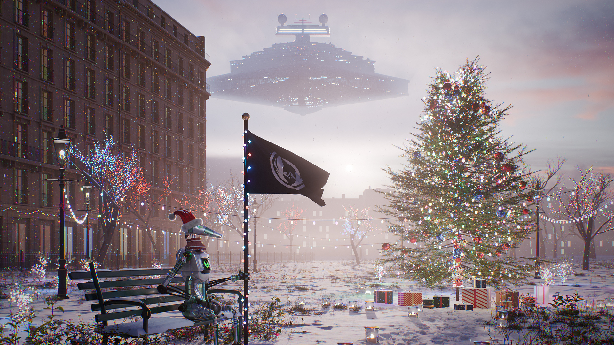

# Bannière de Noël

[4K](banniere_noel_3840.png?raw=true) &nbsp;·&nbsp; [Full HD](banniere_noel_1920.png?raw=true) &nbsp;·&nbsp; [Discord](banniere_noel_960.png?raw=true)

 

## La scène

Un soir de décembre dans un square parisien, au coucher du soleil. Il neige. Roger, bonnet rouge sur la tête, est
assis sur un banc et tient le mât du drapeau de l'Ordre, enroulé d'une guirlande. À côté de lui, un grand sapin
décoré, des cadeaux à son pied. Plus loin, les toits de Paris disparaissent dans la brume dorée, et au-dessus de la
ville un destroyer stellaire sort d'un banc de brouillard, le nez tourné vers nous.

### Dans le détail

- **Roger** : métal argenté, voyants verts, bonnet de Noël en velours bordé de fourrure, banc vert couvert de neige.
- **Le sapin** : plus de 5 mètres, environ 2 600 ampoules et 220 boules, une dizaine de cadeaux emballés à son pied.
- **Le square** : neige piétinée le long des allées, photophores, houx guirlandés, candélabres reliés par des
  guirlandes, arbres nus illuminés et grille en fer forgé.
- **Paris** : un immeuble haussmannien en fuite sur la gauche, puis trois rangées de toits perdues dans la brume,
  jusqu'à 450 mètres.
- **Le destroyer** : 1 600 mètres de long, à plus de 2 kilomètres. Sa couleur se fond dans celle de l'air, comme
  celle d'une montagne au loin, ce qui lui donne sa vraie échelle.
- **La neige** : 22 000 flocons qui tombent dans toute la profondeur de la scène.

 

## Fichiers

| Fichier | Dimensions | Poids | Usage conseillé |
| --- | --- | --- | --- |
| [banniere_noel_3840.png](banniere_noel_3840.png) | 3840 × 2160 | 13 Mo | 4K, qualité maximale |
| [banniere_noel_3840.jpg](banniere_noel_3840.jpg) | 3840 × 2160 | 4,1 Mo | 4K, plus léger |
| [banniere_noel_1920.png](banniere_noel_1920.png) | 1920 × 1080 | 3,6 Mo | Full HD |
| [banniere_noel_1920.jpg](banniere_noel_1920.jpg) | 1920 × 1080 | 1,5 Mo | Full HD, réseaux sociaux |
| [banniere_noel_960.png](banniere_noel_960.png) | 960 × 540 | 1,0 Mo | Bannière de serveur Discord |
| [banniere_noel_960.jpg](banniere_noel_960.jpg) | 960 × 540 | 0,4 Mo | Bannière de serveur Discord |

Les versions 1920 et 960 sont réduites depuis la 4K puis légèrement accentuées : ce sont les plus nettes à leur
taille.

 

## Fabrication

- **Logiciel** : Blender 5.2, moteur de rendu Cycles.
- **Construction** : toute la scène est générée par des scripts Python, de la neige au destroyer.
- **Rendu** : 3840 × 2160, 96 échantillons par pixel, environ 35 minutes sur une Radeon RX 6500M de 4 Go.
- **Prise de vue** : objectif de 35 mm à f/8, mise au point sur Roger.
- **Lumière** : soleil couchant très bas sur l'horizon, ciel rose, brume qui s'épaissit avec la distance.
- **Couleur** : rendu AgX, balance des blancs à 4800 K.
- **Finition** : léger barillet, aberration chromatique, vignetage et grain fin, comme sur une vraie photographie.

 

## Crédits

- Ciel `pink_sunrise`, sapin, candélabres, végétation et textures de neige, de pierre et de pavés :
  [Poly Haven](https://polyhaven.com), sous licence CC0.
- Le destroyer stellaire est un hommage à l'univers Star Wars (Lucasfilm), modélisé ici entièrement en code.
- Roger et le logo appartiennent à L'Ordre des Devs.

 

[Retour à toutes les bannières](../)

