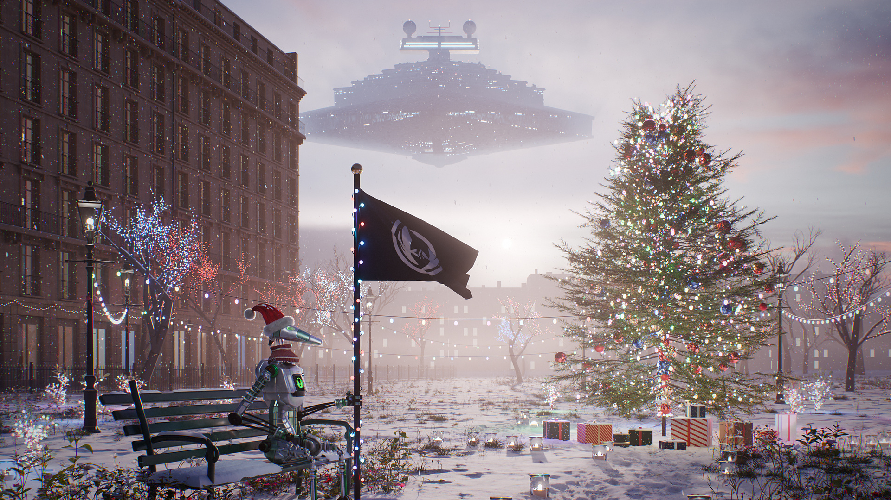

# Bannières de L'Ordre des Devs

Les bannières de [L'Ordre des Devs](https://ordre-des-devs.org), avec Roger, la mascotte de la communauté. 
Des scènes photoréalistes réalisées sur Blender.

 

## Noël

Un soir de décembre dans un square parisien. Roger, bonnet rouge sur la tête, garde le drapeau de l'Ordre depuis
son banc enneigé, à côté d'un grand sapin illuminé et de ses cadeaux. Au-dessus des toits de Paris, noyés dans la
brume du soleil couchant, un destroyer stellaire sort lentement d'un banc de brouillard.

**[Voir la bannière en détail](Noel/)** &nbsp;·&nbsp; [Télécharger en 4K](Noel/banniere_noel_3840.png?raw=true)

 

## Organisation

Chaque bannière a son propre dossier, avec sa description et ses fichiers prêts à l'emploi.

| Dossier | Bannière |
| --- | --- |
| [`Noel/`](Noel/) | Noël dans un square parisien enneigé |

Chaque bannière existe en trois tailles, en PNG (sans perte) et en JPG (plus léger) :

| Taille | Usage conseillé |
| --- | --- |
| 3840 × 2160 | Fond d'écran 4K, impression |
| 1920 × 1080 | Écran Full HD, réseaux sociaux |
| 960 × 540 | Bannière de serveur Discord |

 

## Réalisation

Les scènes sont entièrement construites par des scripts Python pour Blender : terrain, végétation, lumière,
atmosphère, et jusqu'à la pose de Roger. Rien n'est placé à la main, chaque image peut être recalculée à l'identique.
Le rendu se fait avec Cycles, le moteur de lancer de rayons de Blender, puis reçoit une finition photo discrète
(léger barillet, aberration chromatique, vignetage et grain) pour se rapprocher d'une vraie prise de vue.

 

## Crédits

- Roger et le logo appartiennent à L'Ordre des Devs.
- Ciels, végétation et textures : [Poly Haven](https://polyhaven.com), sous licence CC0.
- Le destroyer stellaire de la bannière de Noël est un hommage à l'univers Star Wars (Lucasfilm), modélisé ici
  entièrement en code.

 
May the &lt;/&gt; be with you.

